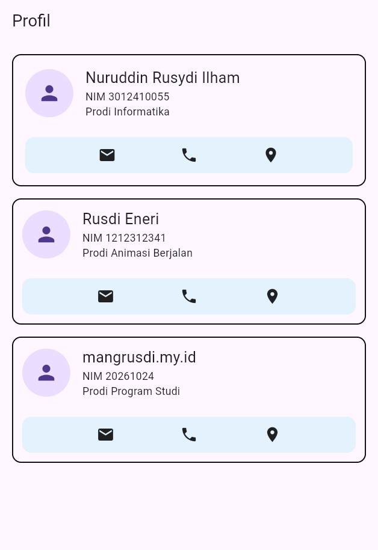
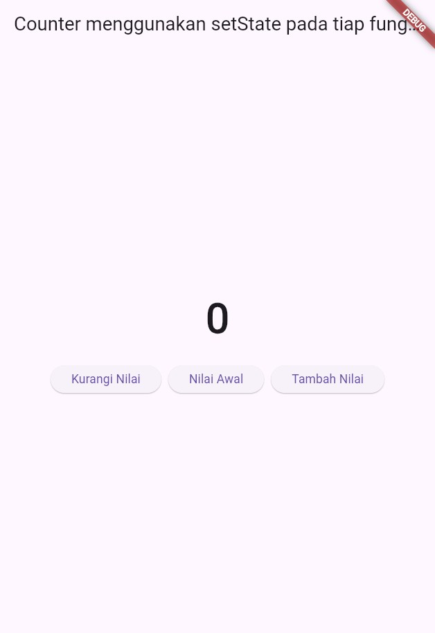
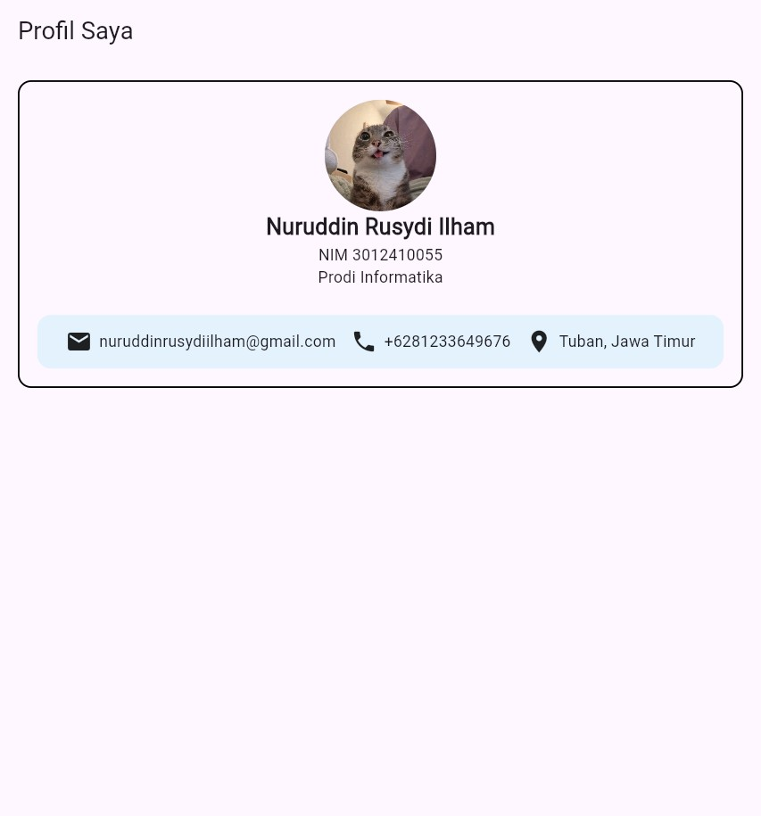

# Tugas Praktikum Flutter - Week 2

Repositori ini berisi tugas latihan dan praktikum pertemuan ke-2 mata kuliah Pemrograman Mobile (Flutter).
- Nama: Nuruddin Rusydi Ilham
- NIM: 3012410055
- Prodi: Informatika

## Hasil Output Tugas (`Tugas_Latihan_1_Pertemuan_2`)

### 1. StatelessWidget (`StatelessWidget.dart`)
Implementasi widget statis (`StatelessWidget`) yang menampilkan daftar kartu profil dengan `Column`, `Row`, `CircleAvatar`, dan `Container`.
- **Path Kode:** `Tugas_Latihan_1_Pertemuan_2/StatelessWidget.dart`
- **Path Output:** `assets/stateless_widget.jpg`

---

### 2. Stateful Counter (`StatefulCounter.dart`)
Implementasi widget dinamis (`StatefulWidget`) dengan manajemen state menggunakan `setState()` pada fungsi `tambahin`, `kurangin`, dan `nilaiAwal` (reset).
- **Path Kode:** `Tugas_Latihan_1_Pertemuan_2/StatefulCounter.dart`
- **Path Output:** `assets/stateful_counter.jpg`

---

### 3. Layout Profile (`LayoutProfile.dart`)
Implementasi tata letak profil mahasiswa dengan foto (`AssetImage`), identitas (Nama, NIM, Program Studi), serta baris info kontak (Email, No. HP, Lokasi).
- **Path Kode:** `Tugas_Latihan_1_Pertemuan_2/LayoutProfile.dart`
- **Path Output:** `assets/layout_profile.jpg`

---

## Getting Started

This project is a starting point for a Flutter application.

A few resources to get you started if this is your first Flutter project:

- [Learn Flutter](https://docs.flutter.dev/get-started/learn-flutter)
- [Write your first Flutter app](https://docs.flutter.dev/get-started/codelab)
- [Flutter learning resources](https://docs.flutter.dev/reference/learning-resources)

For help getting started with Flutter development, view the
[online documentation](https://docs.flutter.dev/), which offers tutorials,
samples, guidance on mobile development, and a full API reference.

